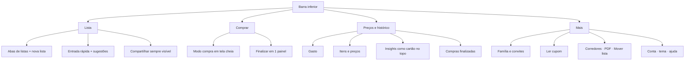

# Diagnóstico de UX: Compra Planejada v5.0.0 (2026-11-09)

Escopo: avaliação heurística (Nielsen + mobile) das jornadas principais. Sem dados de uso e sem usuários ouvidos: tudo que não é observação direta de captura ou código é `[HIPÓTESE]`.
Capturas: `docs/capturas/2026-11/` (citadas por nome; `m-` = `mobile-`, `d-` = `desktop-`; as capturas desktop não citadas ficaram fora do repositório). Capturas feitas em modo "sem conta", com cópia corrigida (1 linha) do app; não alteram o visual.

Pergunta de pesquisa: **o que impede uma pessoa de colocar o primeiro item, fazer a compra e voltar na semana seguinte?**

## 1. Resumo

- `[FATO]` O ciclo central (adicionar → marcar → finalizar) funciona e é curto. A identidade "cupom" dá personalidade e agrupa por corredor sem esforço (m-04).
- `[FATO]` Três fricções de maior impacto:
  1. **A entrada rápida erra sem avisar com preço.** "frango 1,2kg 18,90" virou item "Frango 1,2kg", quantidade 18.9 un (m-04, m-06; `parse.ts:80-89`). A sintaxe real é mais rica que a dica mostrada.
  2. **Fim da compra é um beco sem saída.** Depois de finalizar, a tela diz "Nenhuma lista ainda." sem confirmação, sem resumo e sem botão (m-10; `App.svelte:546-547`). Parece perda de dados.
  3. **O cabeçalho e a lista pedem leitura demais.** 1 título + 1 pílula + abas + "+" + 4 ícones sem rótulo + 2+4 botões, e 4 a 5 controles por item sempre visíveis (m-03, m-04). No mercado, o modo compra ainda mantém o cabeçalho do app, e a chrome fixa ocupa cerca de 38% da altura (m-07).
- `[HIPÓTESE]` O valor que faz a família voltar (preço, recompra, sugestão) só aparece depois de várias compras com valor informado; hoje o app não ajuda a chegar lá nem avisa quando chegou. O núcleo do produto precisa ser decidido antes de polir (seção 9).

## 2. Pontos fortes

- `[FATO]` Prévia ao vivo da interpretação ("→ 2 kg Tomate · Hortifruti") com `aria-live` (`EntradaRapida.svelte:21-27,90`): boa visibilidade do sistema, quando o usuário lê.
- `[FATO]` Entrada com ditado por voz, colar várias linhas e Enter para enviar (`EntradaRapida.svelte:41-67`). Cobre a alternativa ao teclado.
- `[FATO]` Modo compra: linha inteira é alvo de toque (`ItemLinha.svelte:45-50`), fonte maior, progresso e total fixos no rodapé, tela acesa (m-07).
- `[FATO]` Agrupamento por corredor com ordem editável (m-04, m-07).
- `[FATO]` Alternativa a arrastar existe: botões ▲▼ com `aria-label` (`ItemLinha.svelte:67-74`).
- `[FATO]` OCR com contrato claro: "nada entra na lista sozinho", revisão linha a linha, confiança por cor (`TelaCupomOCR.svelte:2-9,86-123`).
- `[FATO]` Honestidade nos modos: "Sem conta, as listas ficam só neste navegador" (m-01) e "Pular" no checkout (m-09). Lista sugerida "nunca vira lista sozinha" (`TelaInsights.svelte:75`).
- `[FATO]` Estados vazios de Preços e Insights dizem o que fazer (m-12; `TelaPrecos.svelte:37`).

## 3. Problemas por jornada

Heurísticas: H1 visibilidade do estado · H2 correspondência com o mundo real · H3 controle e liberdade · H4 consistência · H5 prevenção de erros · H6 reconhecer em vez de lembrar · H7 flexibilidade e eficiência · H8 design minimalista · H9 recuperação de erros · H10 ajuda. Leis: Hick (escolhas), Fitts (alvo), Jakob (convenções).

| # | Jornada | Heurística | Sev. | Achado | Evidência | Recomendação |
|---|---|---|---|---|---|---|
| 1 | Adicionar | H5, H9 | Alto | `[FATO]` Preço no fim vira quantidade; nome fica "Frango 1,2kg" (peso dentro do nome). Item aparece com "18.9" (ponto, sem R$) e unidade "Un." no editor. | m-04, m-06, d-04; `parse.ts:80-89` | `[RECOMENDAÇÃO]` Reconhecer "R$"/vírgula-2-casas no fim como preço; pedir confirmação se número final > 99 sem unidade; mostrar na prévia "preço R$ 18,90". |
| 2 | Adicionar | H6, H7 | Alto | `[FATO]` Sem autocomplete de itens já usados (achado do Head). A dica de sintaxe tem 11 px e o placeholder é fixo "2kg tomate"; o usuário só descobre os padrões por tentativa. | m-03; `EntradaRapida.svelte:76,91-94,117` | `[RECOMENDAÇÃO]` Sugestões abaixo do campo ao digitar (itens frequentes, 1 toque), com quantidade habitual. Alternar o placeholder entre 3 exemplos (com preço, "3 leite", "arroz #Mercearia"). |
| 3 | Adicionar | H1 | Médio | `[HIPÓTESE]` A prévia verde de 11 px abaixo do campo passa despercebida: o erro do item 1 só é visto depois. Validar em teste (tarefa T3). | m-03; `EntradaRapida.svelte:113-116` | Dar mais peso à prévia (corpo 13-14 px) quando houver número final ambíguo. |
| 4 | Adicionar | H4 | Baixo | `[FATO]` Ao adicionar, não há confirmação visual do item novo além de ele surgir no corredor (pode estar fora da tela abaixo). Em lista longa o usuário não vê onde foi parar. | m-04 (lista ocupa a tela toda; campo fica abaixo da dobra) | Rolar até o item e destacá-lo por 1 s; ou fixar o campo de entrada no rodapé como no modo compra. |
| 5 | Gerenciar lista | H8, Hick | Médio | `[FATO]` 5 controles por linha sempre visíveis (check, ⠿, ▲▼, ✎, ×) disputam a atenção com o nome e a quantidade; em 390 px o nome encolhe. | m-04; `ItemLinha.svelte:66-77` | Mostrar só check + nome + qtd; abrir o editor tocando no nome; reordenar e remover dentro do editor ou por deslizar. |
| 6 | Gerenciar lista | Fitts | Médio | `[FATO]` Alvo do check 26 px, ▲▼ 10 px de fonte com padding 3×5 px; o projeto define toque de 44 px (`--tap`). Na lista, só o checkbox marca (nome não é tocável). | `ItemLinha.svelte:89-96,126-129`; `app.css:63` | Linha inteira alterna "comprado" (como no modo compra); ▲▼ só no editor. |
| 7 | Gerenciar lista | H3, H5 | Médio | `[HIPÓTESE]` "×" remove em 1 toque; não verifiquei se há desfazer. Vizinho de "✎" (36 px). | m-04; `ItemLinha.svelte:75-76` | Verificar. Se não há, oferecer "Desfazer" no aviso por 5 s. |
| 8 | Gerenciar lista | H8, Hick | Médio | `[FATO]` Duas ações principais + 4 secundárias (Mover lista, Corredores, PDF, Compartilhar) sempre visíveis; as 4 são raras. Ocupam cerca de 3 linhas de botões. | m-03; `App.svelte:535-544` | Ver seção 4: "Compartilhar" fica visível; as outras três vão para menu "⋯". |
| 9 | Gerenciar lista | H2, H6 | Médio | `[FATO]` 4 ícones emoji sem rótulo no cabeçalho (💰💡📷🕘) só têm `title` (não existe em toque). "💡 Insights" e "💰 Preços" não dizem o que contêm. | m-03; `App.svelte:510-513` | Rótulo textual ou navegação inferior (seção 4). |
| 10 | Gerenciar lista | H1 | Médio | `[FATO]` Pílula de escopo ("Minhas listas") parece rótulo; em "sem conta" fica desabilitada com opacidade 0,7 e continua com cara de botão. Abas das listas aparecem *abaixo* dela (3 níveis: escopo > lista > ações). | m-03; `App.svelte:488-497` | Em "sem conta", esconder a pílula e mostrar "Neste aparelho". Com conta, juntar escopo e lista num seletor só. |
| 11 | Modo compra | Fitts, H8 | Médio | `[FATO]` O cabeçalho do app (título, pílula, abas, 4 ícones, ≈140 px) + barra verde (≈60 px) + rodapé fixo (≈120 px) deixam ~5 itens visíveis em 844 px. | m-07 (medido na imagem, escala 2) | Em modo compra, esconder o cabeçalho do app; "Sair", nome da lista e "Ocultar" numa barra única. |
| 12 | Modo compra | H4, H1 | Médio | `[FATO]` Campo "+ item" aparece flutuando sobre a lista e cobre a quantidade de "Arroz"; o botão diz "Add" (inglês) enquanto o rodapé diz "+ item". | m-07b; `ModoCompra.svelte:105-111,142-144` | Campo fixo acima do rodapé em bloco próprio, botão "Adicionar". `[HIPÓTESE]` Com teclado aberto no celular pode piorar (não testado). |
| 13 | Modo compra | H1, H2 | Médio | `[FATO]` Total fixo "R$ 0,00" aparece mesmo quando ninguém informa preço; número sem sentido. Por outro lado, o app não oferece informar preço ao marcar o item no corredor, que é o momento certo. | m-07; `ModoCompra.svelte:117` | Esconder o total até haver 1 preço. Ao marcar, oferecer campo opcional "R$" (1 toque para pular). |
| 14 | Modo compra | H3 | Baixo | `[FATO]` "Ocultar pegos" é um botão-chave que muda de rótulo; o estado é reiniciado a cada entrada. | m-07; `ModoCompra.svelte:25,85-87` | Lembrar a escolha. Aceitável como está. |
| 15 | Finalizar | H4, H5 | Médio | `[FATO]` Fluxo de duas perguntas em sequência: "Finalizar compra" (lista de pendentes, 2 botões) e "Quanto ficou?" (valor + mercado + "Pular"). Os títulos não dizem "passo 1 de 2". "Apenas finalizar" é ambíguo (apaga os pendentes? perde?). | m-08, m-09; `App.svelte:301-331` | Um só painel: resumo "1 de 6 comprados" + "Criar lista com 5 pendentes" (marcado) + valor e mercado. Rótulo claro: "Descartar pendentes". |
| 16 | Finalizar | H1 | Baixo | `[FATO]` Texto com espaço antes do ponto ("1 item comprado .") e a estimativa só aparece com preços. Lista com 1 de 6 comprados pode ser finalizada sem alerta (m-08 avisa pendentes, mas depois não confirma o que acontece com eles). | m-09; `ModalCheckout.svelte:42-44` | Corrigir texto; explicitar o destino dos pendentes. |
| 17 | Pós-compra | H1, H10 | Alto | `[FATO]` Após finalizar, a tela mostra só "Nenhuma lista ainda." com "+" tracejado; sem aviso de sucesso, sem resumo, sem "Nova lista" em destaque, sem atalho para Preços/Histórico. Quem finaliza por engano não encontra "desfazer" (existe "reativar" no Histórico, escondido em 🕘). | m-10, m-13; `App.svelte:546-547` | Aviso "Compra salva: R$ 85,40 · Extra Savassi · [Desfazer] [Ver histórico]"; criar lista vazia automaticamente ou mostrar CTA "Começar nova lista". |
| 18 | Pós-compra | H2 | Médio | `[FATO]` Histórico mostra "1 de 6 itens · R$ 85,40": comparar 1 item marcado com 6 e um valor de R$ 85 sugere dado errado. Na captura isso vem do fluxo de teste, mas é o que qualquer pessoa que marca pouco veria. | m-13 | Mostrar "1 comprado, 5 não comprados". |
| 19 | Preços | H2, H8 | Médio | `[FATO]` Com 1 compra, "Preços" mostra um gráfico de 1 barra com rótulo "85" (sem R$) e a data, num painel que corta no pé da tela; valor percebido baixo. | m-11; `TelaPrecos.svelte:42-53` | Esconder o gráfico abaixo de 3 compras. Mostrar o progresso: "mais 2 compras com valor para liberar comparações". |
| 20 | Insights | H1, H10 | Médio | `[FATO]` Estado vazio é honesto, porém sem progresso nem exemplo do que virá. Inflação pessoal e recompra precisam de histórico (90 dias e 2+ compras por item, conforme o código). `[HIPÓTESE]` O usuário abandona antes de ver valor. | m-12; `TelaInsights.svelte:39-40` | Mostrar exemplo ilustrativo rotulado "Exemplo (dados fictícios)" e contador de compras faltantes. |
| 21 | Cupom (OCR) | H5, H1 | Médio | `[FATO]` Estado inicial pede foto "bem iluminada e esticada". Erro vai para texto genérico ("Tente uma foto mais nítida") e o botão da câmera chama-se "Escolher foto" mas usa `capture=environment`. Revisão tem 3 campos por linha (nome, qtd, preço) sem rótulo visível. | m-14; `TelaCupomOCR.svelte:53,93-95,115-120` | Mostrar cabeçalho de colunas; guia de enquadramento. Medir acerto real (meta do PLANO ainda sem dado). |
| 22 | Nova lista | H10 | Baixo | `[FATO]` "Lista recorrente" é checkbox sem explicar o efeito (a cada quantos dias? o que acontece?). | m-15 | Texto auxiliar: "Reaparece sozinha depois de finalizar, com itens desmarcados". |
| 23 | Conta | H4 | Baixo | `[FATO]` Em "sem conta", o modal explica que é preciso voltar à tela inicial para entrar, mas não há botão "Entrar agora" nem aviso de que os dados locais não migram. `[HIPÓTESE]` Perda de dados na migração (verificar). | m-16 | Botão "Entrar e manter minhas listas", se tecnicamente possível. |
| 24 | Primeiro acesso | H2 | Médio | `[FATO]` Login mostra 5 opções (Google, e-mail+senha, criar, esqueci, sem conta) antes de qualquer valor demonstrado; a saída "Usar sem conta" é o último item (m-01). Rótulo "mínimo 6 caracteres" fica como placeholder (some ao digitar). | m-01 | Para quem chega por convite, mostrar o que se vai receber. Colocar "Usar sem conta" mais perto do topo para teste rápido. |
| 25 | Onboarding | H2, H10 | Médio | `[FATO]` 4 passos de texto antes da primeira tela útil; "Pular" no canto, alvo 44 px mas texto cinza claro 12,5 px. Promete "avisa quando algo está na hora de recomprar" (sem notificação, ver fatos do Head). Nome "Compras" ≠ "Compra Planejada". | m-02-onboarding-1..4; `TelaOnboarding.svelte:16,22,32,48` | Trocar por 1 tela + dica contextual na lista vazia ("Digite 2kg tomate"). Corrigir promessa. |
| 26 | Lista vazia | H10 | Médio | `[FATO]` "Sua lista está vazia. Adicione itens abaixo." sem exemplo clicável; o campo fica abaixo do recibo (precisa olhar para baixo). | m-03 | Exemplos de 1 toque ("+ leite", "+ pão"), e a opção "Ler cupom" como ponto de partida. |
| 27 | Em todo o app | H9 | Alto | `[FATO]` (referência) Erros de rede e permissão só no console; o usuário não sabe se salvou. Impacta cada jornada compartilhada. | Fatos do Head | Indicador de sincronização ("Salvo", "Sem conexão: sincroniza depois") no cabeçalho. |
| 28 | Famílias (leitura) | H6, H2 | Médio | `[FATO]` O fluxo de família exige: abrir pílula → "Criar uma família" → nome → ⚙️ → "Gerar convite" (papel) → copiar link; o convidado precisa de código de 8 letras ou link. Papéis ("responsável", "editor", "só leitura") aparecem em seletores sem explicar o que cada um pode fazer. | `TelaFamilias.svelte:35-87`, `TelaGerenciarFamilia.svelte:51-93` | Botão único "Convidar pessoa" que gera e abre o compartilhar nativo (WhatsApp) com o link. Descrever os papéis em 1 linha. |
| 29 | Famílias (leitura) | H5 | Médio | `[FATO]` O mesmo botão vermelho vira "Excluir família" ou "Sair da família" conforme o contexto (`TelaGerenciarFamilia.svelte:100`). `[HIPÓTESE]` Pode ser clicado sem confirmação (não verifiquei). | idem | Verificar. Confirmar ações destrutivas dizendo o que se perde. |
| 30 | Modo escuro | H7 | Baixo | `[FATO]` Tema escuro está pronto e legível (d-03b), mas sem alternador; uso à noite ou sob luz forte depende do sistema. | d-03b (forçado por código) | Seguir o sistema + alternador na conta. |

## 4. Arquitetura da informação: proposta

`[FATO]` Hoje: 13 modais por 1 estado (`modalAberto`) e nenhuma rota de navegação; a hierarquia de uso não aparece na tela (m-03). O que é raro (PDF, Mover lista, Corredores) tem o mesmo peso do que é diário (Modo compra).

Frequência de uso `[HIPÓTESE]` (validar): adicionar item e marcar item (várias vezes por semana) > modo compra e finalizar (1x por semana) > compartilhar (1x por compra em família) > preços e histórico (ocasional) > insights, cupom, corredores, PDF, mover (raro).

Proposta `[RECOMENDAÇÃO]`:

- **4 destinos com rótulo e ícone:** Lista · Comprar · Preços · Mais. Remove os 4 emojis soltos e as 4 ações secundárias.
- **Escopo (família) vira cabeçalho da Lista** com nome e avatares; troca por toque no nome.
- "Insights" e "Histórico" entram dentro de Preços (mesmo assunto: dinheiro). Reduz 13 modais para folhas contextuais.
- Cupom (OCR) fica em "Mais" e também como ação na lista vazia e no fim da compra ("Tem o cupom? Leia-o").
- Em tela larga (d-04), recibo central com 560 px e muito espaço vazio: usar barra lateral com os mesmos 4 destinos. `[HIPÓTESE]` Uso em desktop é secundário; validar.
- Custo: mudança de navegação mexe em todo o app. `[RECOMENDAÇÃO]` Fazer por etapas: primeiro rótulos e menu "⋯", depois a barra inferior.

## 5. Linguagem e microcopy

| Hoje | Problema | Proposta |
|---|---|---|
| "Compra Planejada" (título, login) × "Compras" (onboarding, manifest) | Dois nomes (H4) | Escolher um (decisão do usuário/produto). |
| "Minhas listas" (pílula) | Parece título, não botão; "escopo" é termo interno | "Minhas listas ▾" com seta sempre, ou "Só eu". |
| "Corredores" | Pode ser lido como nome de pessoa/lugar; no mercado brasileiro costuma ser "corredor" ou "seção" | "Ordem no mercado" |
| "Mover lista" | Mover para onde? | "Mover para outra família" |
| "Insights", "O que sua cesta está dizendo" | Termo em inglês; título poético sem informação | "Dicas de economia" ou "Seus padrões de compra" |
| "Ler cupom" (📷) | Ok, mas ícone-só | Texto: "Ler cupom fiscal" |
| "Apenas finalizar" | Ambíguo | "Finalizar sem os 5 pendentes" |
| "Add" no modo compra | Inglês, inconsistente | "Adicionar" |
| "Nenhuma lista ainda." / "Sua lista está vazia." | Sem próximo passo | "Sua lista está vazia. Digite o primeiro item ou diga em voz alta." |
| "pegos" / "pegou" / "pega" | Coloquial, bom no mercado; consistente | Manter (ponto forte); alinhar com "comprados" no recibo. |
| "18.9" / "Un." | Formato errado em pt-BR (ponto) | "R$ 18,90" e "un" |

Promessa × entrega `[FATO]`: "avisa quando algo está na hora de recomprar" (`TelaOnboarding.svelte:32`) não tem notificação; "Economize sem esforço" (m-02-onboarding-4) exige informar valor a cada compra. `[RECOMENDAÇÃO]` Prometer apenas o que existe: "mostra o que está na hora de recomprar quando você abre o app".

## 6. Personas provisórias `[HIPÓTESE]` (sem pesquisa; nenhuma citação real)

**P1. Quem faz a compra da casa (35-50 anos)** `[HIPÓTESE]`
- Contexto: lista no celular durante a semana, faz a compra aos sábados, com pressa, uma mão ocupada pelo carrinho.
- Precisa: adicionar item em segundos, ver o que falta, marcar sem erro, dividir com o parceiro.
- Validar: com que frequência adiciona no momento em que lembra (cozinha) × no mercado? Usa voz? Quem digita preço?

**P2. Quem recebe e executa a lista (parceiro/filho, 20-60 anos)** `[HIPÓTESE]`
- Contexto: entra por convite, só marca itens ou acrescenta pontualmente; pode ir ao mercado sem ter montado a lista.
- Precisa: entrar sem criar conta complicada, entender o que é "só leitura" × "editor", ver quem pegou o quê.
- Validar: o convite por código de 8 letras/link funciona no WhatsApp? Quanto tempo do link até o primeiro item marcado?

**P3. Pessoa idosa ou com pouca familiaridade digital** `[HIPÓTESE]`
- Contexto: usa o celular com fonte do sistema grande, não conhece sintaxe, não escreve "2kg"; talvez fale itens.
- Precisa: texto maior (hoje 11-12,5 px em várias partes), ícones com texto, poucas ações na tela.
- Validar: consegue adicionar o primeiro item sem ajuda? Lê as dicas de 11 px? Entende "Insights"?

`[HIPÓTESE]` Os dados do app indicam uso próprio e familiar hoje (PLANO §7); essas personas descrevem o que a decisão de mercado exigiria testar, não o público atual.

## 7. Referências de mercado

Pesquisa feita em 2026-11-09; fontes de terceiros e de marketing dos concorrentes (Listonic compara com AnyList na própria página): tratar como indicação, não como fato de uso.

| Referência | O que faz | Vale adotar? |
|---|---|---|
| Bring! | Catálogo de itens com ícone e categoria automática; item novo ganha ícone sugerido; visualização em blocos ou lista; convite por mensagem, SMS e e-mail; "Inspirações" com receitas que enviam ingredientes à lista. Fontes: [Central de ajuda, listas](https://getbring.com/help-center-main-categories/items-lists), [Organizado](https://www.getbring.com/en/features/organized), [Inspirado](https://getbring.com/en/features/inspired). | Sim, em parte: sugestão visual de itens frequentes (toque, sem digitar) e ícone por categoria no lugar do texto cinza do corredor. Receitas: não (fora do núcleo). Uma resenha citada em fonte reclama de ícone errado: manter correção em 1 toque. |
| AnyList | Favoritos, agrupamento e categorias editáveis, compartilhamento com aviso quando alguém muda a lista; receitas e planejador no plano pago. Fonte: [AnyList, recursos](https://anylist.com/features). Comparação (parcial): [Listonic](https://listonic.com/anylist-shopping-list-app-comparison/). | Sim: aviso "Maria marcou 3 itens" para famílias; lista de favoritos. |
| Listonic | Agrupa por corredor, categorias editáveis e adiciona preço por item (segundo a página da própria Listonic, não confirmado na fonte do concorrente). Fonte: [Listonic vs AnyList](https://listonic.com/compare-apps/listonic-vs-anylist). | Sim: preço por item como campo opcional, mas sem forçar. |
| Google Keep | `[NÃO VERIFICADO]` Notas com caixas de seleção, itens marcados descem para o fim, compartilhamento por e-mail, ditado. Não consultei fonte. | Padrão: "marcado vai para o fim da lista" (hoje o app risca e deixa no lugar, m-07). Verificar fonte antes de citar. |

`[RECOMENDAÇÃO]` Adotar sem perder a identidade: (a) chips de sugestão em tinta mono, (b) ícone-carimbo por categoria nos cabeçalhos de corredor, (c) "marcados" recolhidos num bloco "No carrinho (3)" ao fim do recibo, (d) compartilhar com um toque.

## 8. Acessibilidade vivida (sem auditoria WCAG)

- `[FATO]` Botões do cabeçalho são só emoji; em toque não há `title`, então "💡" e "💰" não são compreensíveis (m-03). Leitor de tela depende de `title` (`App.svelte:510-513`), sem `aria-label` nos quatro.
- `[FATO]` Alvos pequenos: check de 26 px, ▲▼ de 10 px, ícones de 34 px (`ItemLinha.svelte:89-129`, `App.svelte:656`). Dedos maiores ou tremor erram o alvo.
- `[FATO]` Texto: 11 px (dica, previa, pílula), 12,5 px (subtítulos, linhas), em fonte mono, com cor cinza sobre papel bege (m-03, m-11). Contraste: `[NÃO VERIFICADO]` (calcular com ferramenta; é papel do qa-engineer).
- `[FATO]` Arrastar depende de alça de 15 px (`ItemLinha.svelte:132-135`); há ▲▼, mas também pequenos. A reordenação é secundária, então o risco é baixo.
- `[FATO]` Ditado por voz existe só quando o navegador suporta (`EntradaRapida.svelte:29-31,84`); sem aviso quando não existe.
- `[FATO]` Mensagens de erro e confirmação não chegam ao usuário (fato do Head) e aparecem por 1 aviso temporário sem controle (toast), o que não atende quem lê devagar.
- `[HIPÓTESE]` Luz forte: papel bege com verde-escuro tem contraste suficiente, mas a fonte de 11-12 px sob sol é ilegível; testar no mercado, não só no laboratório.
- Conectividade: modo offline existe (PWA); porém sem indicador de estado, o usuário em conexão ruim não sabe o que sincronizou.

## 9. Plano de validação com usuários

**Método** `[RECOMENDAÇÃO]`: teste moderado, remoto ou presencial, 5 pessoas (2 com perfil P1, 1 com P2 sem conta, 1 com 60+ anos, 1 sem hábito de apps de lista), celular próprio, 30 min cada. Protocolo "pensar em voz alta". Sem gravar dados pessoais; consentimento por escrito, dados anonimizados.

| Tarefa | O que mede | Critério de sucesso (`[HIPÓTESE]` a calibrar) |
|---|---|---|
| T1. Abrir o app e adicionar "leite" (primeiro acesso, escolher entre entrar ou usar sem conta) | Tempo até o primeiro item (meta do PLANO: ≤ 8 s) | Mediana ≤ 8 s com conta já criada; ≤ 60 s no primeiro uso, sem ajuda. |
| T2. Adicionar 5 itens de uma lista em papel (com quantidades e um com preço) | Erros de interpretação; descoberta da sintaxe | ≥ 4 de 5 sem corrigir; 0 itens com preço virando quantidade. |
| T3. Marcar 3 itens, depois editar a quantidade de 1 | Alvos de toque e descoberta do editor | ≥ 90% de acerto no primeiro toque. |
| T4. Simular a compra: entrar no modo compra, marcar, adicionar 1 item novo, finalizar informando R$ e mercado | Sucesso do fluxo, entendimento de "pendentes" | 5/5 concluem; ninguém pergunta "e agora?" após finalizar. |
| T5. Convidar outra pessoa para a lista | Tempo e erros no fluxo de família | ≥ 4/5 convidam em ≤ 2 min sem ajuda. |
| T6. Responder "quanto gastei no último mês?" e "o que está na hora de comprar?" | Valor percebido de Preços/Insights | ≥ 3/5 encontram a resposta em ≤ 30 s. |

Métricas: tempo por tarefa (cronômetro), taxa de sucesso (concluiu sem ajuda), contagem de erros, **SUS** (10 perguntas, ao fim; referência de uso comum: média de 68; fonte a conferir antes de citar), e 1 pergunta de facilidade por tarefa (SEQ, 1-7).

Observação cega ao app: pedir que a pessoa descreva em voz alta o que cada ícone do cabeçalho faz *antes* de tocar.

**3 perguntas de entrevista para decidir o núcleo do produto** (antes das tarefas):
1. "Conte a última vez que você fez compras de mercado: como decidiu o que comprar, onde anotou e o que deu errado?" (descobre se o problema é lembrar, dividir ou gastar menos)
2. "Quem mais participa dessa compra e como vocês combinam hoje?" (testa se família é o núcleo ou um extra)
3. "O que você faria com o histórico do que gastou: olharia? Para quê? Pagaria por isso?" (testa o valor de preços/insights e a viabilidade do plano Pro)

Decisão que as respostas informam: núcleo = lista compartilhada rápida, gasto/economia, ou planejamento recorrente (seção 10).

## 10. Evolução 6-12 meses da experiência

`[HIPÓTESE]` Uma família só considera o app indispensável se ele reduzir o esforço de **todo o ciclo**, não de uma etapa. Sequência proposta (priorização formal é do product-manager):

**0-2 meses: confiança e rapidez no básico**
- Corrigir erros que quebram confiança: preço lido como quantidade, tela pós-compra, aviso de sincronização/erro, promessa de aviso inexistente.
- Sugestões ao digitar e itens frequentes em 1 toque (alvo: primeiro item ≤ 8 s).
- Modo compra limpo (sem cabeçalho, total só com preço, marcar com preço opcional).

**2-6 meses: o ciclo da família**
- Convidar em 1 toque pelo WhatsApp; "quem pegou o quê" em tempo real; aviso "Ana está no mercado" (a base de presença já existe em `ModoCompra.svelte:36`).
- Lista recorrente "feita para você": ao abrir, o app mostra "Provavelmente está na hora de" com os itens atrasados em 1 toque (hoje escondido em 💡).
- Notificação local ou e-mail semanal ("sábado: 8 itens sugeridos") somente se a validação mostrar que ajuda; hoje não existe.

**6-12 meses: valor acumulado**
- Compare mercados e preços *dentro* da lista ("Arroz: R$ 24 no Extra, R$ 21 no Atacadão") quando houver dados suficientes.
- Orçamento do mês por família e alerta suave, sem moralismo.
- Receitas ou refeições da semana → itens da lista (se as entrevistas apontarem; Bring!/AnyList fazem, mas é um produto maior).
- Onboarding por situação: "Vou comprar agora", "Vou compartilhar com alguém", "Quero economizar".

`[RECOMENDAÇÃO]` Medir antes de decidir: adicionar eventos mínimos (primeiro item, item por sessão, compra finalizada, valor informado, convite aceito) com dados agregados e consentimento. Hoje não há analytics, então a North Star do PLANO (compras finalizadas por família por mês) não é medida apesar de marcada como "medindo ✅" em §5. `[FATO]` PLANO-EVOLUCAO-PRODUTO.md:538-545.

## 11. Fora do meu papel

- Especificar tela de navegação inferior, chips de sugestão, ícones-carimbo, tokens de tipografia e cor → ui-product-design.
- Implementar correção do parser, autocomplete, modo compra e pós-compra → frontend-engineer.
- Auditoria WCAG (contraste, foco em modais, leitor de tela, alvos) → qa-engineer.
- Priorizar os itens deste diagnóstico, decidir mercado × uso familiar e o modelo Pro → product-manager (e business-strategy).
- Instrumentação de analytics (eventos, consentimento, LGPD) → data-bi-engineer e devsecops-engineer.

## 12. Não verificado

- Fluxos de família e OCR com foto: avaliados só por leitura de código; não vistos na tela.
- Contraste, tamanho real em dispositivo físico e legibilidade sob luz forte: nada medido.
- Comportamento do campo "+ item" com teclado aberto no celular (m-07b é captura estática).
- Se "×" remover item tem desfazer; se "Excluir família"/"Sair" pede confirmação.
- Migração dos dados do modo "sem conta" ao entrar com conta (achado 23).
- Reduções de altura ("≈140 px", "≈38%") estimadas nas capturas de escala 2: conferir em 390×844 no navegador.
- Fonte para a média de 68 do SUS e para Google Keep; confirmar antes de publicar.
- Frequência de uso por função e perfis são suposições; nenhum dado de uso existe.
- Capturas desktop avaliadas só em d-03b e d-04; as demais telas desktop foram vistas por correspondência com as de celular, sem leitura individual.
